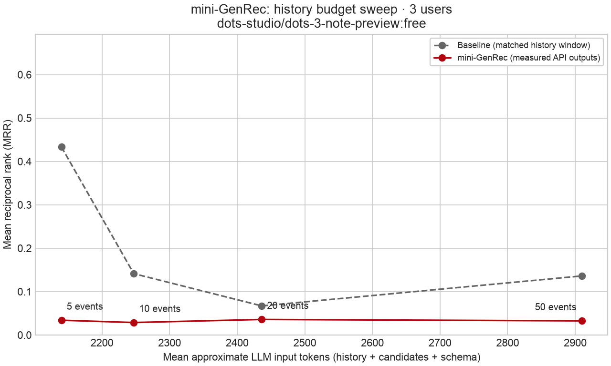
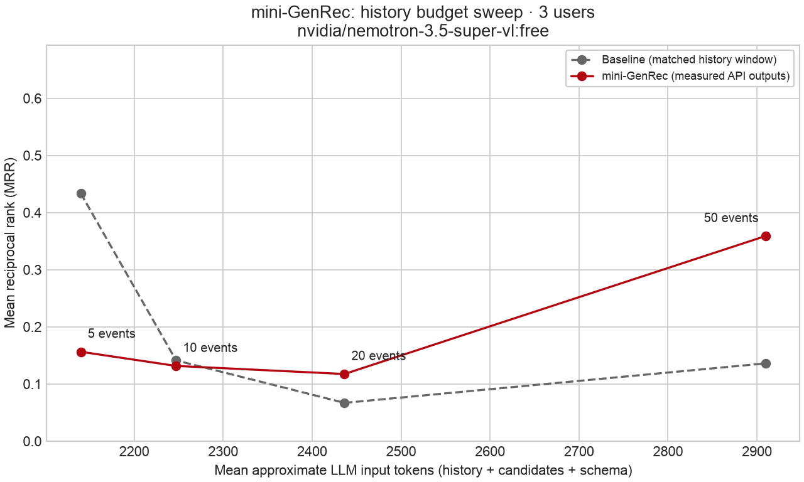
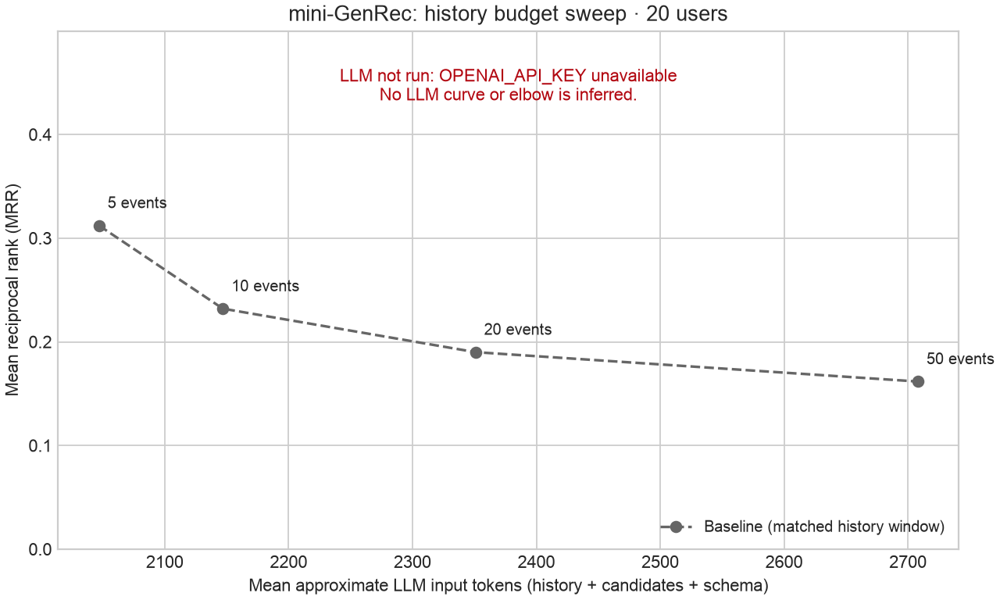
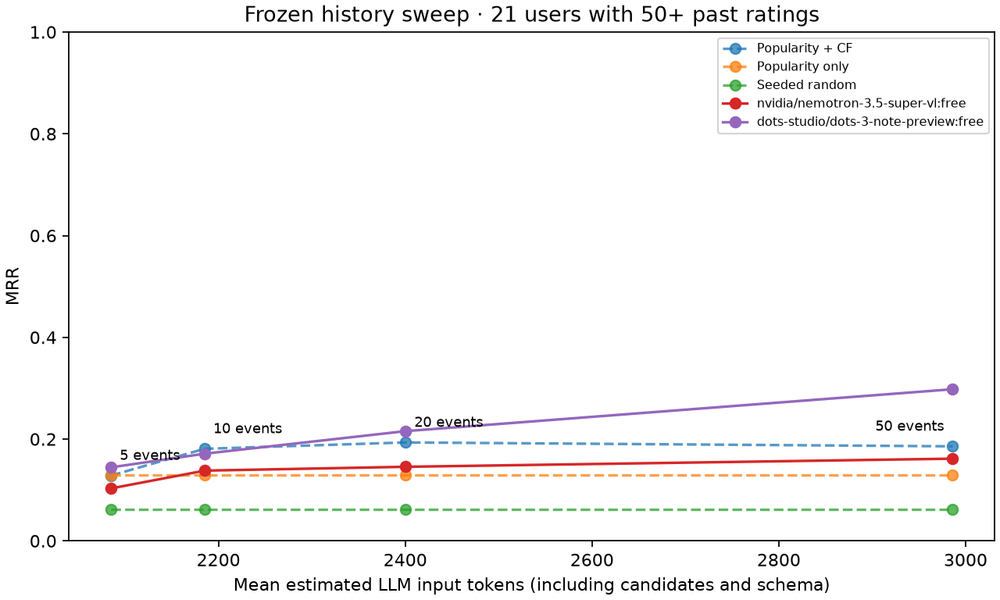

# mini-GenRec

A weekend-sized, **unfine-tuned** experiment inspired by [GenRec: Towards LLM-Native Recommendation at Netflix](https://netflixtechblog.com/genrec-towards-llm-native-recommendation-at-netflix-f20be6f643e3), Ying Li, Arjun Rao and Shradha Sehgal, Netflix Tech Blog, July 30, 2026. The source post was fetched and read for this implementation.

Netflix trains a foundation model and a catalog scoring head together, then scores without decoding recommendations. This repo uses off-the-shelf models through OpenAI or OpenRouter to **generate a candidate ranking**, with a code-enforced catalog gate. It reproduces the context and measurement ideas, not Netflix's architecture, training, serving costs, or claimed performance.

## Frozen experiment inputs

Open the [offline results viewer](results/frozen-evaluation/viewer.html) in a browser. On GitHub, download the HTML file first. It needs no server, API key, or network access. Select a user, switch history conditions, and reveal the held-out movie; the example buttons highlight disagreements between the rankers. Rebuild the single-file viewer from the saved artifacts with `python -m mini_genrec.viewer` in the project environment.

The [mini-genrec-v1 snapshot](experiments/mini-genrec-v1/README.md) preserves the planned configuration and fixed cohorts: 3 development users, 34 evaluation users and a 21-user long-history subset. It includes targets, ordered candidate sets, complete eligible rating histories, the catalog, dataset hashes and prompt fingerprints. The snapshot's files and historical status are unchanged. **`mini_genrec.experiment` now consumes this manifest**, with plain-history prompts, popularity-only and seeded-random controls. The legacy `mini_genrec.evaluate` CLI still uses its original sample-selection behavior.

## Run the frozen experiment

After installing dependencies and downloading MovieLens as described below, validate the entire plan locally:

```bash
python -m mini_genrec.experiment --dry-run
```

Dry run is the default: it checks snapshot/dataset fingerprints, restores the exact frozen cases, reproduces the engineered prompt fingerprints, builds the plain-history conditions and prints the 330-condition plan. It makes no model calls, needs no API key, and writes no results.

Measure the three classic rankers without any model calls:

```bash
python -m mini_genrec.experiment --baseline-only --output results/frozen-baselines
```

The local controls use the frozen hybrid parameters, training-count popularity with movie-ID tie-breaking, and a per-user seeded shuffle. The random control hashes a versioned seed domain separately from candidate sampling, and is invariant to candidate input order. Plain history retains neutral ratings and repeats, packs the newest complete events under pressure, then serializes retained events chronologically. The engineered condition preserves every historical prompt fingerprint.

To later start the free-model experiment, inference must be explicitly enabled:

```bash
# Requires OPENROUTER_API_KEY in .env. This command makes API requests.
python -m mini_genrec.experiment --execute
```

The freeze file's `inference_enabled=false` records the historical planning boundary; it is not silently edited or treated as authorization. The new runner requires the explicit `--execute` flag. It permits only models from the frozen named `:free` list, shares the 40-attempt budget, and pauses on quota/budget exhaustion. Repeat the identical command to resume; completed condition records are not requested again. Cached responses remain reusable if a process stopped after an API response but before its checkpoint was written.

The main and plain-history comparisons each use 34 users. The elbow uses only the fixed 21 users with 50+ past catalog ratings, reusing their 20-event engineered predictions from the main comparison. Total: **68 main + 68 plain + 68 unconstrained + 126 additional elbow = 330 logical conditions**. Smaller runs use `--limit-users N`, taking prefixes of the saved cohort order; `--cohort development` explicitly selects the three pilot users. `--models MODEL_ID` can select a subset of the frozen model list. Changing the selected cohort/models or ranking code requires a new output directory; resuming with a different request budget is allowed.

Outputs default to `results/frozen/mini-genrec-v1/RUN_ID/`; a custom `--output` directory must be new or have a matching checkpoint. `run.json` records the frozen configuration, selection, code fingerprints and run identity. `state.json` checkpoints each LLM condition and invocation's uncached attempts. Final `per_user.json`, `metrics.csv`, `report.md`, `elbow.csv`, `elbow.json` and `elbow.png` keep main/context/unconstrained/elbow views separate. Baseline-only reports explicitly leave LLM scores unmeasured. Partial runs publish status/checkpoints, not aggregate tables.

Candidate coverage is unique valid ranked candidates / 50. A short or empty valid JSON ranking is a completeness failure, not a parse error; absent targets still score zero. Reports distinguish incompleteness from refusals, truncations, malformed JSON/schema, connection/timeouts, HTTP errors, configuration/authentication failures and budget/quota pauses. Fatal configuration failures stop the run. Unknown cost metadata stays unknown. Native provider tokens and original request latency are separate from estimated prompt size; checkpoint/cache reuse is recorded without treating it as fresh inference.

The completed frozen-cohort LLM results are recorded at the end of this README. The earlier three-user live pilot below remains separate. Replay the saved audit without an API key or new inference:

```bash
python -m mini_genrec.analysis --results results/frozen-evaluation
```

The initial live run stopped at 237 conditions on a provider HTTP 400. The runner was corrected to score upstream provider rejections as failed requests while keeping configuration errors fatal. The same 237 outcomes replayed from cache with identical scores; the cohorts, prompts, and generation settings stayed fixed. See the [recovery record](results/frozen-evaluation/recovery.json) and [initial checkpoint status](results/frozen-evaluation-interrupted/status.json).

Measured local controls on the **34 frozen evaluation users**, with the prespecified 20-event window:

| Ranker | MRR | Hit@10 | Candidate coverage |
|---|---:|---:|---:|
| Popularity + CF | 0.2220 | 50.0% | 100% |
| Popularity only | 0.1466 | 38.2% | 100% |
| Seeded random | 0.0539 | 5.9% | 100% |

These are measured finite-sample results, including the single prespecified random seed. They are not directly comparable to the three-user pilot. The saved [local report](results/frozen-baselines/report.md), [metrics](results/frozen-baselines/metrics.csv) and [matched-cohort history sweep](results/frozen-baselines/elbow.png) contain 291 control predictions, zero completed LLM conditions and zero API attempts.

## Method in ten lines

1. Download the public [MovieLens ml-latest-small](https://grouplens.org/datasets/movielens/latest/) archive; retain its upstream README/license locally.
2. Freeze training strictly before the dataset's 80th-percentile timestamp; choose the 1,000 most-rated movies using only that period.
3. Fit the baseline on users with 20+ catalog ratings in that training period; use no held-out or future ratings for similarities or popularity.
4. Test users need 20+ strictly earlier catalog ratings; hold out each user's latest **overall** rating, only if it is in the catalog and at/after the cutoff.
5. Fix 50 candidates per user: the target plus 49 uniformly sampled, previously unrated catalog distractors; shuffle once with seed 42.
6. Baseline: 80% normalized item-CF affinity plus 20% log popularity; cosine similarities use positive (4+ star) interactions and overlap shrinkage.
7. Verbalize the last 5, 10, 20 or 50 catalog ratings with titles, stars, genres and relative age. Ratings are proxies, not verified watches.
8. Omit neutral (2.5–3.5 star) ratings, compress repeated movie ratings, prioritize strong preferences, and pack events within a token budget.
9. Ask `gpt-4o-mini` (configurable) to order exact candidate titles; drop unknown, ambiguous, noncandidate and duplicate titles without backfilling.
10. Measure MRR, Hit@10, popularity share and hallucinations; run one free-catalog probe per user and plot quality against input tokens.

## Run

Python **3.10+** recommended (verified with 3.12). No fine-tuning, server, database or GPU.

```bash
python3 -m venv .venv
source .venv/bin/activate
pip install -r requirements.txt
cp .env.example .env
# Set OPENAI_API_KEY in .env, or export it in your shell. Never commit it.
python -m mini_genrec.evaluate --users 20 --update-readme
python -m unittest discover -s tests -v
```

For a free local run without credentials:

```bash
python -m mini_genrec.evaluate --baseline-only --users 20 --update-readme
```

## Compare free models through OpenRouter

OpenRouter is supported using the existing OpenAI-compatible SDK transport, with the fixed endpoint `https://openrouter.ai/api/v1`. Set **`OPENROUTER_API_KEY`** in `.env`; an OpenAI key is not required for this backend. No credential values are included in requests' cache keys, prompts, reports, or logs.

List the current public model catalog without an API key:

```bash
python -m mini_genrec.openrouter
```

Pick explicit named models ending in **`:free`** that advertise `structured_outputs`. The listing distinguishes JSON-schema support from generic `response_format` support. Support depends on the actual serving endpoint, so first run one user. Availability and model IDs change; a model appearing in the catalog is not a completed compatibility or recommendation-quality test. [Public model catalog](https://openrouter.ai/api/v1/models), [structured-output documentation](https://openrouter.ai/docs/guides/features/structured-outputs).

For example, these two IDs advertised structured outputs when the catalog was checked on November 6, 2026 and subsequently passed live one-user smoke tests:

```bash
# One model, one user: 5 logical requests, including all four history windows.
python -m mini_genrec.evaluate --backend openrouter \
  --model nvidia/nemotron-3.5-super-vl:free --reasoning off \
  --users 1 --output results/openrouter-smoke-nemotron

# Two models, three identical test users: 30 logical requests total.
python -m mini_genrec.evaluate --backend openrouter \
  --models nvidia/nemotron-3.5-super-vl:free dots-studio/dots-3-note-preview:free \
  --reasoning off --users 3 --output results/openrouter-comparison
```

The matrix produces a directory per model containing the normal artifacts, plus **`comparison.csv`** and **`comparison.md`** at its root. Every model uses the same user IDs, targets and candidate sets. Each cache key includes the backend and complete request; resolved model, provider (when returned), usage and original request latency are recorded. Matrix mode preserves the README's original measured run even with `--update-readme`. Separate invocations can compare different samples: compare only matching seeds, cohort sizes, catalog/candidate settings, token budgets and dataset hashes.

This backend intentionally accepts only **named `:free` variants**. Paid models, `openrouter/auto`, and `openrouter/free` are rejected; the latter would mix models within an experiment. Requests specify `provider.require_parameters=true` so incompatible endpoints cannot silently ignore the JSON-schema setting. We do not fall back to other model IDs or relax output validation. No compatible endpoint means a configuration error to investigate, not permission to use a paid variant. Provider implementations still vary; Python validates every response.

The current no-purchase free tier allows **20 requests/minute and 50 requests/day across the account**; failed attempts also count. Other activity on the account consumes the same allowance. This is a rate-limited service, not unlimited free inference. See [OpenRouter's free-model limits](https://openrouter.ai/collections/free-models) and [account limits API](https://openrouter.ai/docs/api/reference/limits).

For OpenRouter, the runner spaces uncached requests at least **3.1 seconds apart**, disables SDK retries, and shares a default **40-attempt budget across all models in one invocation**. Adjust with `--request-budget 1..50`. This guard is not an account-wide quota tracker. Cache hits consume no local attempt budget. On quota errors or budget exhaustion, the run stops with an `incomplete` status; rerun the identical command later to reuse cached responses. No partial aggregate model comparison is published. The default 20-user experiment needs 100 logical requests per model, so plan to resume across days; failed requests may require additional quota. Treat only directories with `status.json` set to `complete` as completed runs, since older report files can remain during an interrupted rerun.

`--reasoning off` sends OpenRouter's `reasoning.enabled=false`; use it only with models that support disabling reasoning. Models requiring reasoning can consume the entire output allowance before emitting a ranking. `--max-output-tokens` defaults to 2400 and includes reasoning plus visible output. Both settings are part of the cache identity. API-reported reasoning tokens, response finish reason, visible response length and cost (where returned) are recorded. See [OpenRouter reasoning controls](https://openrouter.ai/docs/guides/best-practices/reasoning-tokens).

**Live OpenRouter smoke tests have now run.** The initial Liquid model failed four of five requests at the output limit; Nvidia and Dots completed all five requests each. The live results below are separate from mocked automated tests, whose outputs never enter the checked-in measured results. The `.env` key remains local and ignored by Git.

The default API experiment makes **100 logical requests per model**: 20 users × (four constrained windows + one unconstrained 20-event probe). On the OpenAI backend SDK retries may add requests. Start with `--users 3 --output results/smoke` for 15 logical requests. Defaults: `--backend openai`, `--model gpt-4o-mini`, `--token-budget 4096`, `--candidates 50`, `--catalog-size 1000`, `--seed 42`; all are configurable. Model overrides must support Chat Completions, structured JSON output and temperature 0. The tokenizer falls back to `cl100k_base` for unknown model names; this is a cross-model estimate, not their native tokenization. API-reported token counts are recorded separately. First run needs network access for data and tokenizer assets.

`--token-budget` covers tokenizer-counted messages, schema and a 64-token framing allowance; it is an **estimated input budget**, not a guaranteed provider limit. API-reported usage is stored separately. Candidate metadata is never truncated: an impossible budget raises an error. `prompts.json` records exactly what would be sent; the target label is never identified to the LLM. History lengths are **caps**: users with fewer than 50 past catalog ratings contribute their available history to that condition. Per-user `window_events` and retained-event counts expose this. Baseline uses the same raw history window; LLM context compaction can discard or reorder events within that window. The baseline's fixed blend is a simple stand-in, not a production-tuned model.

`.env` is loaded locally and ignored by Git. `data/` and `cache/` are also ignored. Cache keys hash the complete request (model, prompts, schema and generation settings); rerunning an interrupted API experiment reuses completed responses. `per_user.json` is checkpointed after each completed user. Authentication/configuration errors stop the run; other request/parse failures yield an empty ranking, zero MRR/Hit@10, and a recorded error. SDK error bodies and secrets are never written to artifacts. No fallback baseline scores are reported as LLM predictions. Temperature 0 does not guarantee deterministic provider responses; retain cached outputs and the recorded resolved model for comparison.

## Evaluation definitions and limitations

- **MRR** averages the reciprocal target rank; absent targets get 0. **Hit@10** averages target membership in the first 10 unique valid results. All requested users remain in these denominators, including failures.
- **Catalog** means the selected MovieLens subset, not all movies ever made. Hallucination here is a membership error, not proof a title is fictional. Free-catalog recommendations get no candidate list: `outside_catalog_rate` is unmatched raw titles / all returned title strings. Exact matching allows Unicode/case/whitespace normalization, but requires the year and MovieLens's title wording; aliases can inflate the measured rate.
- The constrained run also reports **outside-candidate rate** (including real catalog movies outside the supplied 50). It uses structural [OpenAI Structured Outputs](https://developers.openai.com/api/docs/guides/structured-outputs), with **no title enum** in the schema. Candidate membership is validated independently in Python. The unconstrained probe keeps the same JSON structure but removes the candidate list and catalog instruction.
- **Popularity bias** is the micro-averaged fraction of valid top-10 results in the most-rated 10% of catalog movies, using training counts. Report slot coverage alongside it so short/empty rankings cannot conceal failures. Unmatched suggestions stay in hallucination denominators; duplicates are counted and removed. There is no candidate-filling fallback.
- Histories may contain observations after the common training cutoff, but strictly before their own target. This is a frozen baseline with an updated user profile. All ties at the target timestamp are excluded from history; the largest movie ID breaks ties when choosing the latest target. Users whose actual latest movie is outside the catalog are excluded, never assigned an older substitute.
- Uniform negatives and a small sample make this easier than full-catalog retrieval. Rated movies may be disliked; next-rating prediction is not satisfaction prediction. MovieLens and the LLM's possible prior knowledge of it do not represent Netflix traffic. No significance or superiority claim is justified by this demo.
- The exploratory **elbow** is the smallest tested history within **0.01 absolute MRR** of the best observed LLM result. All four conditions must finish without request/parse errors before an elbow is declared. It is not an independently validated optimum. The main table always uses the prespecified 20-event window.
- Raw dataset SHA-256 hashes, shared cutoff, candidates, user IDs, model, run arguments, API token usage, prompts and per-user outputs are saved for audit. `requirements.txt` uses bounded compatible versions; `requirements-lock.txt` records the environment used for the checked-in run.

<!-- OPENROUTER_LIVE_START -->
## Live OpenRouter comparison

Measured on 3 identical users, 50 candidates each, seed 42, and the same 1,000-movie catalog. Both models used `--reasoning off`, a 2,400-token output cap and a 4,096 estimated input-token cap. This is a smoke-sized comparison; it does not establish statistical superiority. One of the three held-out ratings was below 4 stars.

| Method (20-event window) | MRR | Hit@10 | Popular share of top-10 |
|---|---:|---:|---:|
| Popularity + item-CF | 0.0670 | 0.0% | 13.3% |
| Nvidia Nemotron | 0.1175 | 33.3% | 6.7% |
| Dots | 0.0358 | 0.0% | 10.0% |

### What broke first in live testing

- Initial Liquid smoke test: 4/5 responses hit the 2,400-token output limit without a usable ranking. The model requires reasoning, so disabling reasoning is not a valid fix for it. The failed conditions remain recorded in [the Liquid report](results/openrouter-smoke/report.md).
- Xing smoke test: its endpoint returned HTTP 429 before completing a user. The account allowance check still showed 994 requests remaining, so this was not exhaustion of that daily allowance. This incomplete run is excluded from the quality comparison.
- Dots: 100/644 raw constrained suggestions were outside the candidate sets (15.5%) and were dropped. 10/12 validated candidate rankings contained fewer than 50 movies. Unconstrained catalog-mismatch rate: 7/30 (23.3%). Exact title matching can count aliases as catalog mismatches.
- Nvidia Nemotron: 131/727 raw constrained suggestions were outside the candidate sets (18.0%) and were dropped. 3/12 validated candidate rankings contained fewer than 50 movies. Unconstrained catalog-mismatch rate: 5/30 (16.7%). Exact title matching can count aliases as catalog mismatches.
- Reliability: 0/30 evaluated model conditions failed to return parseable responses; cached responses are included in these counts. All requests used named `:free` variants. Cost metadata was available for 20/30 conditions and totaled $0.00; missing cost fields remain unknown rather than being filled with zero.

### History sweep

Each model was evaluated at history caps of 5, 10, 20 and 50 on the same users. The plots use estimated input tokens; native API input counts are saved separately. The reported elbow rule is exploratory, and the 50-event condition can contain fewer events for users with shorter histories.

Dots: the descriptive 0.01-MRR rule selects a history cap of 5 (best observed MRR 0.0358).



[Dots full report](results/openrouter-comparison/dots-studio_dots-3-note-preview_free-952e7a96/report.md) · [Elbow CSV](results/openrouter-comparison/dots-studio_dots-3-note-preview_free-952e7a96/elbow.csv)

Nvidia Nemotron: the descriptive 0.01-MRR rule selects a history cap of 50 (best observed MRR 0.3590).



[Nvidia Nemotron full report](results/openrouter-comparison/nvidia_nemotron-3.5-super-vl_free-f96f1282/report.md) · [Elbow CSV](results/openrouter-comparison/nvidia_nemotron-3.5-super-vl_free-f96f1282/elbow.csv)

[Full comparison table](results/openrouter-comparison/comparison.md) · [Comparison CSV](results/openrouter-comparison/comparison.csv)
<!-- OPENROUTER_LIVE_END -->

## Original baseline run

This 20-user baseline-only run predates the live OpenRouter evaluation. Its missing LLM measurements refer to this original run, not the later experiments in the OpenRouter result directories.

<!-- RESULTS_START -->
Run mode: **baseline-only**. Backend: `openai`. Model configured: `gpt-4o-mini`. Seed 42; 20 users; 50 candidates; 1000 catalog movies.

| Ranker (20-event window) | Users | MRR | Hit@10 | Popular share of top-10 |
|---|---:|---:|---:|---:|
| baseline | 20 | 0.1901 | 0.4500 | 21.0% |
| mini-GenRec | 0 | not run | not run | not run |

| History window | Mean retained high-signal events | Approx. input tokens | Baseline MRR | mini-GenRec MRR |
|---:|---:|---:|---:|---:|
| 5 | 3.8 | 2047 | 0.3122 | not run / unavailable |
| 10 | 7.2 | 2147 | 0.2320 | not run / unavailable |
| 20 | 14.1 | 2351 | 0.1901 | not run / unavailable |
| 50 | 26.3 | 2708 | 0.1617 | not run / unavailable |



Elbow: Requires all four measured LLM conditions without errors.

### What broke first

- Data coverage: 37 users qualified after the temporal/catalog/history filters; this run sampled 20. 13 held-out ratings were below 4 stars. MovieLens ratings are an imperfect proxy for next watches or satisfaction.
- Baseline misses: 11/20 targets missed the top 10 at 20 events. Its popular-item top-10 share was 21.0%.
- Context at 50 events: 256 neutral ratings omitted; 0 high-signal events dropped for the token budget; 0 repeat events compressed. Counts are across evaluated users. MovieLens normally has one rating per user/movie.
- LLM not run: OPENAI_API_KEY unavailable. **0 LLM calls were made**; the full run needs 100 logical requests before retries (four history windows plus one unconstrained probe per user). LLM MRR, Hit@10, hallucination, popularity bias, and the elbow remain unmeasured.

Measured artifacts: [metrics.csv](results/metrics.csv), [elbow.csv](results/elbow.csv), [run.json](results/run.json), [per_user.json](results/per_user.json), [cases.json](results/cases.json), [prompts.json](results/prompts.json).
<!-- RESULTS_END -->

<!-- FROZEN_RESULTS_START -->
## Completed frozen evaluation

Audited 621 predictions, including 330 LLM conditions. Recomputed rank metrics and verified catalog/candidate membership from the saved rankings. Replayed title validation from archived raw responses for 326 successful conditions.

| Ranker (20-event window) | Users | MRR | Hit@10 | Popular share | Candidate coverage |
|---|---:|---:|---:|---:|---:|
| baseline | 34 | 0.2220 | 50.0% | 24.1% | 100.0% |
| popularity | 34 | 0.1466 | 38.2% | 38.2% | 100.0% |
| random | 34 | 0.0539 | 5.9% | 8.2% | 100.0% |
| dots-studio/dots-3-note-preview:free | 34 | 0.2358 | 35.3% | 8.5% | 90.8% |
| nvidia/nemotron-3.5-super-vl:free | 34 | 0.2464 | 38.2% | 8.5% | 97.6% |

## Context comparison

| Model | Strategy | MRR | Hit@10 | Estimated input tokens | Native input tokens | Retained events |
|---|---|---:|---:|---:|---:|---:|
| nvidia/nemotron-3.5-super-vl:free | engineered_v1 | 0.2464 | 38.2% | 2436 | 2486 | 14.9 |
| nvidia/nemotron-3.5-super-vl:free | plain_recent | 0.2076 | 38.2% | 2592 | 2654 | 20.0 |
| dots-studio/dots-3-note-preview:free | engineered_v1 | 0.2358 | 35.3% | 2436 | 2367 | 14.9 |
| dots-studio/dots-3-note-preview:free | plain_recent | 0.2135 | 23.5% | 2592 | 2532 | 20.0 |

## Paired comparisons

Differences use the same 34 users. Intervals are 95% percentile bootstrap intervals with 10,000 paired-user resamples and seed 42. Request/parse failures remain zero-score observations. These exploratory intervals are not adjusted for multiple comparisons; they do not establish production superiority.

| Comparison (left minus right) | MRR difference | 95% interval | Hit@10 difference | 95% interval |
|---|---:|---|---:|---|
| nvidia/nemotron-3.5-super-vl:free: engineered minus hybrid baseline | +0.0244 | [-0.1102, +0.1665] | -11.8% | [-29.4%, +5.9%] |
| nvidia/nemotron-3.5-super-vl:free: engineered minus plain | +0.0387 | [-0.0673, +0.1517] | +0.0% | [-11.8%, +11.8%] |
| dots-studio/dots-3-note-preview:free: engineered minus hybrid baseline | +0.0138 | [-0.1094, +0.1426] | -14.7% | [-32.4%, +2.9%] |
| dots-studio/dots-3-note-preview:free: engineered minus plain | +0.0223 | [-0.0763, +0.1187] | +11.8% | [-2.9%, +26.5%] |
| nvidia/nemotron-3.5-super-vl:free minus dots-studio/dots-3-note-preview:free: engineered | +0.0106 | [-0.1245, +0.1564] | +2.9% | [-14.7%, +20.6%] |

## What broke first

- `nvidia/nemotron-3.5-super-vl:free`: 1/165 request/parse failures; 1206/7426 constrained suggestions outside candidates (16.2%); 67/131 incomplete validated rankings. Unconstrained catalog mismatches: 197/340 (57.9%).
- `dots-studio/dots-3-note-preview:free`: 3/165 request/parse failures; 880/6939 constrained suggestions outside candidates (12.7%); 78/131 incomplete validated rankings. Unconstrained catalog mismatches: 169/340 (49.7%).

Catalog mismatches include title/year matching failures and do not prove a movie is fictional. Invalid suggestions were dropped; no candidate backfill was used.

Provider-reported cost: $0.0000 across 327/330 known cost fields. Unknown costs have not been replaced with zero.

The history sweep uses the same 21 users with 50+ past catalog ratings at all four lengths. The 20-event predictions are reused from the main experiment; no duplicate inference is counted.

## History-length interpretation

- `nvidia/nemotron-3.5-super-vl:free`: no elbow declared. Requires all four measured LLM conditions without errors.
- `dots-studio/dots-3-note-preview:free`: no elbow declared. Requires all four measured LLM conditions without errors.



[All conditions and diagnostics](results/frozen-evaluation/report.md) · [Metrics CSV](results/frozen-evaluation/metrics.csv) · [Paired comparison CSV](results/frozen-evaluation/paired_comparisons.csv) · [History sweep CSV](results/frozen-evaluation/elbow.csv)
<!-- FROZEN_RESULTS_END -->
