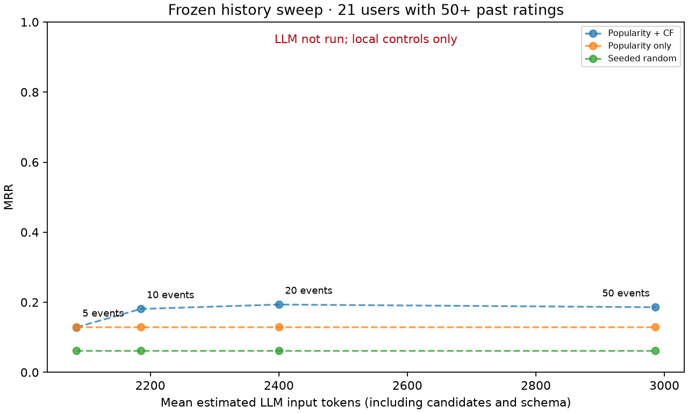

# Frozen experiment results

Mode: **baseline-only**. Users: 34; elbow subset: 21.

| View | Model | Ranker | Strategy | History | Users | MRR | Hit@10 | Candidate coverage | Errors |
|---|---|---|---|---:|---:|---:|---:|---:|---:|
| main | local | baseline | raw_recent | 20 | 34 | 0.2220 | 0.5000 | 100.0% | 0 |
| main | local | popularity | raw_recent | 20 | 34 | 0.1466 | 0.3824 | 100.0% | 0 |
| main | local | random | raw_recent | 20 | 34 | 0.0539 | 0.0588 | 100.0% | 0 |
| elbow | local | baseline | raw_recent | 5 | 21 | 0.1285 | 0.2381 | 100.0% | 0 |
| elbow | local | popularity | raw_recent | 5 | 21 | 0.1288 | 0.2857 | 100.0% | 0 |
| elbow | local | random | raw_recent | 5 | 21 | 0.0620 | 0.0952 | 100.0% | 0 |
| elbow | local | baseline | raw_recent | 10 | 21 | 0.1809 | 0.2857 | 100.0% | 0 |
| elbow | local | popularity | raw_recent | 10 | 21 | 0.1288 | 0.2857 | 100.0% | 0 |
| elbow | local | random | raw_recent | 10 | 21 | 0.0620 | 0.0952 | 100.0% | 0 |
| elbow | local | baseline | raw_recent | 20 | 21 | 0.1935 | 0.3810 | 100.0% | 0 |
| elbow | local | popularity | raw_recent | 20 | 21 | 0.1288 | 0.2857 | 100.0% | 0 |
| elbow | local | random | raw_recent | 20 | 21 | 0.0620 | 0.0952 | 100.0% | 0 |
| elbow | local | baseline | raw_recent | 50 | 21 | 0.1858 | 0.3810 | 100.0% | 0 |
| elbow | local | popularity | raw_recent | 50 | 21 | 0.1288 | 0.2857 | 100.0% | 0 |
| elbow | local | random | raw_recent | 50 | 21 | 0.0620 | 0.0952 | 100.0% | 0 |

LLM conditions were not run. No LLM scores or elbow are inferred.

## Response diagnostics

| Model | Strategy | History | Invalid candidates | Catalog mismatches | Incomplete rankings | Failure categories |
|---|---|---:|---:|---:|---:|---|

[History sweep CSV](elbow.csv)
