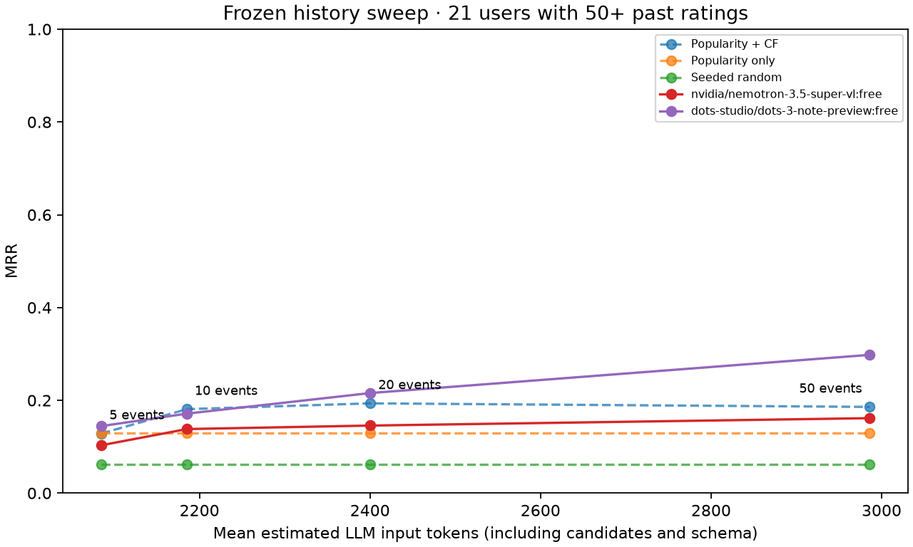

# Frozen evaluation audit

Audited 621 predictions, including 330 LLM conditions. Recomputed rank metrics and verified catalog/candidate membership from the saved rankings. Replayed title validation from archived raw responses for 326 successful conditions.

| Ranker (20-event window) | Users | MRR | Hit@10 | Popular share | Candidate coverage |
|---|---:|---:|---:|---:|---:|
| baseline | 34 | 0.2220 | 50.0% | 24.1% | 100.0% |
| popularity | 34 | 0.1466 | 38.2% | 38.2% | 100.0% |
| random | 34 | 0.0539 | 5.9% | 8.2% | 100.0% |
| dots-studio/dots-3-note-preview:free | 34 | 0.2358 | 35.3% | 8.5% | 90.8% |
| nvidia/nemotron-3.5-super-vl:free | 34 | 0.2464 | 38.2% | 8.5% | 97.6% |

## Context comparison

| Model | Strategy | MRR | Hit@10 | Estimated input tokens | Native input tokens | Retained events |
|---|---|---:|---:|---:|---:|---:|
| nvidia/nemotron-3.5-super-vl:free | engineered_v1 | 0.2464 | 38.2% | 2436 | 2486 | 14.9 |
| nvidia/nemotron-3.5-super-vl:free | plain_recent | 0.2076 | 38.2% | 2592 | 2654 | 20.0 |
| dots-studio/dots-3-note-preview:free | engineered_v1 | 0.2358 | 35.3% | 2436 | 2367 | 14.9 |
| dots-studio/dots-3-note-preview:free | plain_recent | 0.2135 | 23.5% | 2592 | 2532 | 20.0 |

## Paired comparisons

Differences use the same 34 users. Intervals are 95% percentile bootstrap intervals with 10,000 paired-user resamples and seed 42. Request/parse failures remain zero-score observations. These exploratory intervals are not adjusted for multiple comparisons; they do not establish production superiority.

| Comparison (left minus right) | MRR difference | 95% interval | Hit@10 difference | 95% interval |
|---|---:|---|---:|---|
| nvidia/nemotron-3.5-super-vl:free: engineered minus hybrid baseline | +0.0244 | [-0.1102, +0.1665] | -11.8% | [-29.4%, +5.9%] |
| nvidia/nemotron-3.5-super-vl:free: engineered minus plain | +0.0387 | [-0.0673, +0.1517] | +0.0% | [-11.8%, +11.8%] |
| dots-studio/dots-3-note-preview:free: engineered minus hybrid baseline | +0.0138 | [-0.1094, +0.1426] | -14.7% | [-32.4%, +2.9%] |
| dots-studio/dots-3-note-preview:free: engineered minus plain | +0.0223 | [-0.0763, +0.1187] | +11.8% | [-2.9%, +26.5%] |
| nvidia/nemotron-3.5-super-vl:free minus dots-studio/dots-3-note-preview:free: engineered | +0.0106 | [-0.1245, +0.1564] | +2.9% | [-14.7%, +20.6%] |

## What broke first

- `nvidia/nemotron-3.5-super-vl:free`: 1/165 request/parse failures; 1206/7426 constrained suggestions outside candidates (16.2%); 67/131 incomplete validated rankings. Unconstrained catalog mismatches: 197/340 (57.9%).
- `dots-studio/dots-3-note-preview:free`: 3/165 request/parse failures; 880/6939 constrained suggestions outside candidates (12.7%); 78/131 incomplete validated rankings. Unconstrained catalog mismatches: 169/340 (49.7%).

Catalog mismatches include title/year matching failures and do not prove a movie is fictional. Invalid suggestions were dropped; no candidate backfill was used.

Provider-reported cost: $0.0000 across 327/330 known cost fields. Unknown costs have not been replaced with zero.

The history sweep uses the same 21 users with 50+ past catalog ratings at all four lengths. The 20-event predictions are reused from the main experiment; no duplicate inference is counted.

## History-length interpretation

- `nvidia/nemotron-3.5-super-vl:free`: no elbow declared. Requires all four measured LLM conditions without errors.
- `dots-studio/dots-3-note-preview:free`: no elbow declared. Requires all four measured LLM conditions without errors.

[All conditions and diagnostics](report.md) · [Metrics CSV](metrics.csv) · [Paired comparison CSV](paired_comparisons.csv) · [History sweep CSV](elbow.csv)
