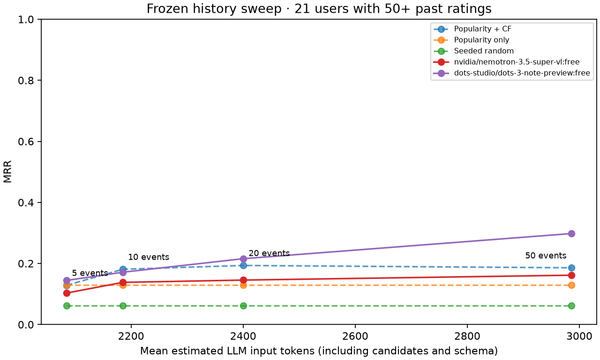

# Frozen experiment results

Mode: **api**. Users: 34; elbow subset: 21.

| View | Model | Ranker | Strategy | History | Users | MRR | Hit@10 | Candidate coverage | Errors |
|---|---|---|---|---:|---:|---:|---:|---:|---:|
| main | local | baseline | raw_recent | 20 | 34 | 0.2220 | 0.5000 | 100.0% | 0 |
| main | local | popularity | raw_recent | 20 | 34 | 0.1466 | 0.3824 | 100.0% | 0 |
| main | local | random | raw_recent | 20 | 34 | 0.0539 | 0.0588 | 100.0% | 0 |
| main | dots-studio/dots-3-note-preview:free | mini-genrec | engineered_v1 | 20 | 34 | 0.2358 | 0.3529 | 90.8% | 1 |
| main | nvidia/nemotron-3.5-super-vl:free | mini-genrec | engineered_v1 | 20 | 34 | 0.2464 | 0.3824 | 97.6% | 0 |
| context | dots-studio/dots-3-note-preview:free | mini-genrec | engineered_v1 | 20 | 34 | 0.2358 | 0.3529 | 90.8% | 1 |
| context | dots-studio/dots-3-note-preview:free | mini-genrec | plain_recent | 20 | 34 | 0.2135 | 0.2353 | 91.9% | 1 |
| context | nvidia/nemotron-3.5-super-vl:free | mini-genrec | engineered_v1 | 20 | 34 | 0.2464 | 0.3824 | 97.6% | 0 |
| context | nvidia/nemotron-3.5-super-vl:free | mini-genrec | plain_recent | 20 | 34 | 0.2076 | 0.3824 | 92.8% | 0 |
| unconstrained | dots-studio/dots-3-note-preview:free | unconstrained | engineered_v1 | 20 | 34 | n/a | n/a | not run / unavailable | 0 |
| unconstrained | nvidia/nemotron-3.5-super-vl:free | unconstrained | engineered_v1 | 20 | 34 | n/a | n/a | not run / unavailable | 0 |
| elbow | local | baseline | raw_recent | 5 | 21 | 0.1285 | 0.2381 | 100.0% | 0 |
| elbow | local | popularity | raw_recent | 5 | 21 | 0.1288 | 0.2857 | 100.0% | 0 |
| elbow | local | random | raw_recent | 5 | 21 | 0.0620 | 0.0952 | 100.0% | 0 |
| elbow | local | baseline | raw_recent | 10 | 21 | 0.1809 | 0.2857 | 100.0% | 0 |
| elbow | local | popularity | raw_recent | 10 | 21 | 0.1288 | 0.2857 | 100.0% | 0 |
| elbow | local | random | raw_recent | 10 | 21 | 0.0620 | 0.0952 | 100.0% | 0 |
| elbow | local | baseline | raw_recent | 20 | 21 | 0.1935 | 0.3810 | 100.0% | 0 |
| elbow | local | popularity | raw_recent | 20 | 21 | 0.1288 | 0.2857 | 100.0% | 0 |
| elbow | local | random | raw_recent | 20 | 21 | 0.0620 | 0.0952 | 100.0% | 0 |
| elbow | local | baseline | raw_recent | 50 | 21 | 0.1858 | 0.3810 | 100.0% | 0 |
| elbow | local | popularity | raw_recent | 50 | 21 | 0.1288 | 0.2857 | 100.0% | 0 |
| elbow | local | random | raw_recent | 50 | 21 | 0.0620 | 0.0952 | 100.0% | 0 |
| elbow | dots-studio/dots-3-note-preview:free | mini-genrec | engineered_v1 | 20 | 21 | 0.2157 | 0.3810 | 93.4% | 0 |
| elbow | dots-studio/dots-3-note-preview:free | mini-genrec | engineered_v1 | 5 | 21 | 0.1445 | 0.2857 | 95.3% | 0 |
| elbow | dots-studio/dots-3-note-preview:free | mini-genrec | engineered_v1 | 10 | 21 | 0.1713 | 0.2381 | 89.7% | 1 |
| elbow | dots-studio/dots-3-note-preview:free | mini-genrec | engineered_v1 | 50 | 21 | 0.2980 | 0.4286 | 96.0% | 0 |
| elbow | nvidia/nemotron-3.5-super-vl:free | mini-genrec | engineered_v1 | 20 | 21 | 0.1456 | 0.1905 | 98.2% | 0 |
| elbow | nvidia/nemotron-3.5-super-vl:free | mini-genrec | engineered_v1 | 5 | 21 | 0.1032 | 0.2381 | 94.8% | 1 |
| elbow | nvidia/nemotron-3.5-super-vl:free | mini-genrec | engineered_v1 | 10 | 21 | 0.1381 | 0.3810 | 97.0% | 0 |
| elbow | nvidia/nemotron-3.5-super-vl:free | mini-genrec | engineered_v1 | 50 | 21 | 0.1616 | 0.3810 | 91.9% | 0 |

nvidia/nemotron-3.5-super-vl:free: Requires all four measured LLM conditions without errors.

dots-studio/dots-3-note-preview:free: Requires all four measured LLM conditions without errors.

## Response diagnostics

| Model | Strategy | History | Invalid candidates | Catalog mismatches | Incomplete rankings | Failure categories |
|---|---|---:|---:|---:|---:|---|
| dots-studio/dots-3-note-preview:free | engineered_v1 (mini-genrec) | 20 | 11.8% | 6.1% | 21 | `{"provider_rejection": 1}` |
| dots-studio/dots-3-note-preview:free | plain_recent (mini-genrec) | 20 | 16.9% | 4.8% | 21 | `{"provider_rejection": 1}` |
| nvidia/nemotron-3.5-super-vl:free | engineered_v1 (mini-genrec) | 20 | 13.8% | 2.4% | 17 | `{}` |
| nvidia/nemotron-3.5-super-vl:free | plain_recent (mini-genrec) | 20 | 23.9% | 5.9% | 24 | `{}` |
| dots-studio/dots-3-note-preview:free | engineered_v1 (unconstrained) | 20 | not run / unavailable | 49.7% | 0 | `{}` |
| nvidia/nemotron-3.5-super-vl:free | engineered_v1 (unconstrained) | 20 | not run / unavailable | 57.9% | 0 | `{}` |
| dots-studio/dots-3-note-preview:free | engineered_v1 (mini-genrec) | 20 | 12.4% | 5.9% | 12 | `{}` |
| dots-studio/dots-3-note-preview:free | engineered_v1 (mini-genrec) | 5 | 5.0% | 4.0% | 12 | `{}` |
| dots-studio/dots-3-note-preview:free | engineered_v1 (mini-genrec) | 10 | 8.9% | 5.4% | 12 | `{"provider_rejection": 1}` |
| dots-studio/dots-3-note-preview:free | engineered_v1 (mini-genrec) | 50 | 17.3% | 4.5% | 12 | `{}` |
| nvidia/nemotron-3.5-super-vl:free | engineered_v1 (mini-genrec) | 20 | 13.3% | 2.4% | 10 | `{}` |
| nvidia/nemotron-3.5-super-vl:free | engineered_v1 (mini-genrec) | 5 | 4.3% | 0.3% | 6 | `{"truncation": 1}` |
| nvidia/nemotron-3.5-super-vl:free | engineered_v1 (mini-genrec) | 10 | 10.8% | 2.5% | 8 | `{}` |
| nvidia/nemotron-3.5-super-vl:free | engineered_v1 (mini-genrec) | 50 | 22.3% | 3.5% | 12 | `{}` |

[History sweep CSV](elbow.csv)
