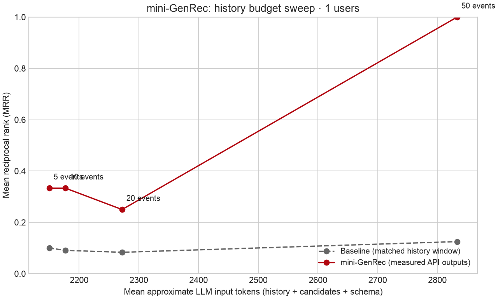

Run mode: **api**. Backend: `openrouter`. Model configured: `nvidia/nemotron-3.5-super-vl:free`. Seed 42; 1 users; 50 candidates; 1000 catalog movies.

| Ranker (20-event window) | Users | MRR | Hit@10 | Popular share of top-10 |
|---|---:|---:|---:|---:|
| baseline | 1 | 0.0833 | 0.0000 | 10.0% |
| mini-genrec | 1 | 0.2500 | 1.0000 | 0.0% |

| History window | Mean retained high-signal events | Approx. input tokens | Baseline MRR | mini-GenRec MRR |
|---:|---:|---:|---:|---:|
| 5 | 5.0 | 2150 | 0.1000 | 0.3333 |
| 10 | 6.0 | 2177 | 0.0909 | 0.3333 |
| 20 | 9.0 | 2272 | 0.0833 | 0.2500 |
| 50 | 28.0 | 2833 | 0.1250 | 1.0000 |

Elbow: Smallest history within 0.01 absolute MRR of the best observed point; exploratory.

### What broke first

- Data coverage: 37 users qualified after the temporal/catalog/history filters; this run sampled 1. 0 held-out ratings were below 4 stars. MovieLens ratings are an imperfect proxy for next watches or satisfaction.
- Baseline misses: 1/1 targets missed the top 10 at 20 events. Its popular-item top-10 share was 10.0%.
- Context at 50 events: 22 neutral ratings omitted; 0 high-signal events dropped for the token budget; 0 repeat events compressed. Counts are across evaluated users. MovieLens normally has one rating per user/movie.
- mini-genrec, 5 events: 55 raw suggestions; out-of-catalog rate 0.0%; outside-candidate rate 9.1%; 0 duplicates; 0/1 failed responses; top-10 slot coverage 100.0%.
- mini-genrec, 10 events: 56 raw suggestions; out-of-catalog rate 0.0%; outside-candidate rate 10.7%; 0 duplicates; 0/1 failed responses; top-10 slot coverage 100.0%.
- mini-genrec, 20 events: 59 raw suggestions; out-of-catalog rate 0.0%; outside-candidate rate 15.3%; 0 duplicates; 0/1 failed responses; top-10 slot coverage 100.0%.
- mini-genrec, 50 events: 50 raw suggestions; out-of-catalog rate 0.0%; outside-candidate rate 0.0%; 0 duplicates; 0/1 failed responses; top-10 slot coverage 100.0%.
- unconstrained, 20 events: 10 raw suggestions; out-of-catalog rate 20.0%; outside-candidate rate not run / unavailable; 0 duplicates; 0/1 failed responses; top-10 slot coverage 80.0%.

Measured artifacts: [metrics.csv](metrics.csv), [elbow.csv](elbow.csv), [run.json](run.json), [per_user.json](per_user.json), [cases.json](cases.json), [prompts.json](prompts.json).
