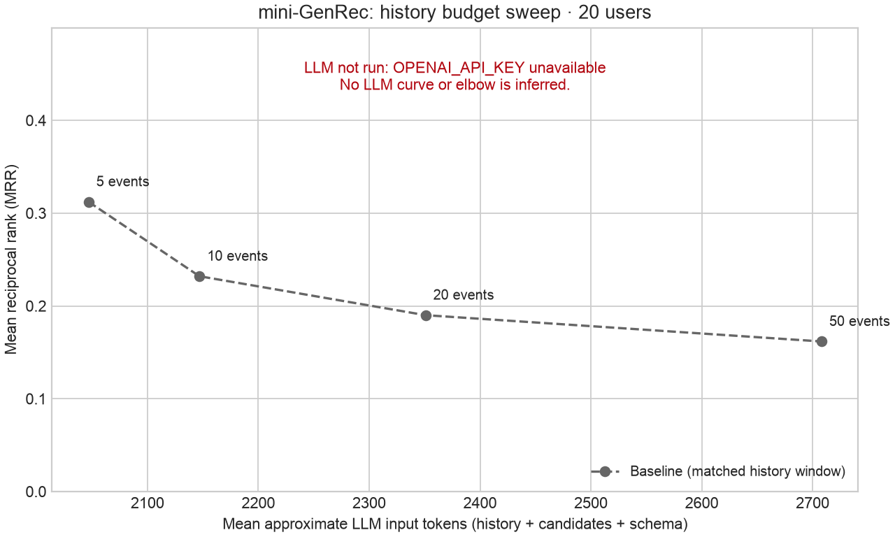

Run mode: **baseline-only**. Backend: `openai`. Model configured: `gpt-4o-mini`. Seed 42; 20 users; 50 candidates; 1000 catalog movies.

| Ranker (20-event window) | Users | MRR | Hit@10 | Popular share of top-10 |
|---|---:|---:|---:|---:|
| baseline | 20 | 0.1901 | 0.4500 | 21.0% |
| mini-GenRec | 0 | not run | not run | not run |

| History window | Mean retained high-signal events | Approx. input tokens | Baseline MRR | mini-GenRec MRR |
|---:|---:|---:|---:|---:|
| 5 | 3.8 | 2047 | 0.3122 | not run / unavailable |
| 10 | 7.2 | 2147 | 0.2320 | not run / unavailable |
| 20 | 14.1 | 2351 | 0.1901 | not run / unavailable |
| 50 | 26.3 | 2708 | 0.1617 | not run / unavailable |

Elbow: Requires all four measured LLM conditions without errors.

### What broke first

- Data coverage: 37 users qualified after the temporal/catalog/history filters; this run sampled 20. 13 held-out ratings were below 4 stars. MovieLens ratings are an imperfect proxy for next watches or satisfaction.
- Baseline misses: 11/20 targets missed the top 10 at 20 events. Its popular-item top-10 share was 21.0%.
- Context at 50 events: 256 neutral ratings omitted; 0 high-signal events dropped for the token budget; 0 repeat events compressed. Counts are across evaluated users. MovieLens normally has one rating per user/movie.
- LLM not run: OPENAI_API_KEY unavailable. **0 LLM calls were made**; the full run needs 100 logical requests before retries (four history windows plus one unconstrained probe per user). LLM MRR, Hit@10, hallucination, popularity bias, and the elbow remain unmeasured.

Measured artifacts: [metrics.csv](metrics.csv), [elbow.csv](elbow.csv), [run.json](run.json), [per_user.json](per_user.json), [cases.json](cases.json), [prompts.json](prompts.json).
